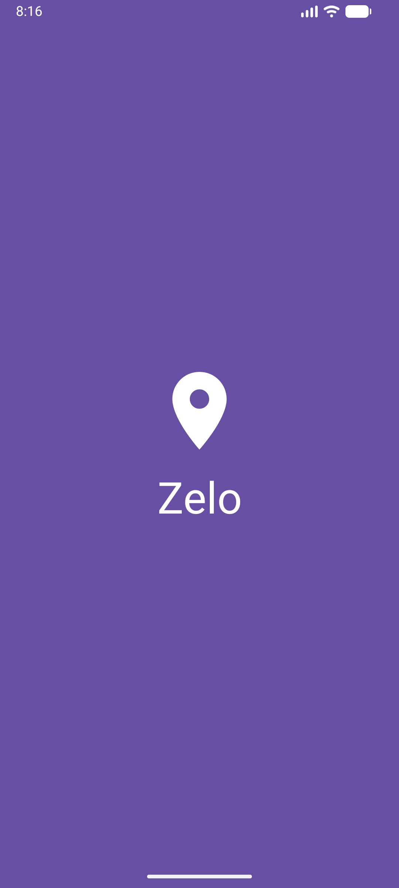
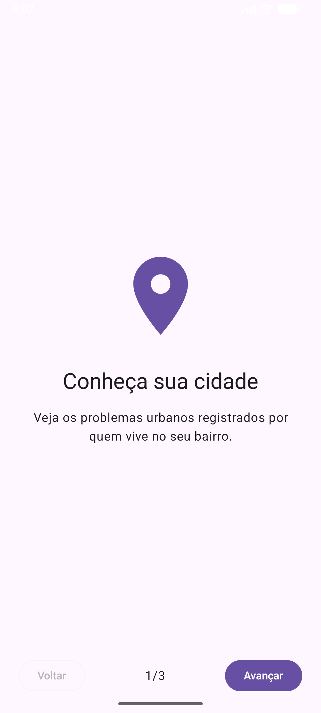
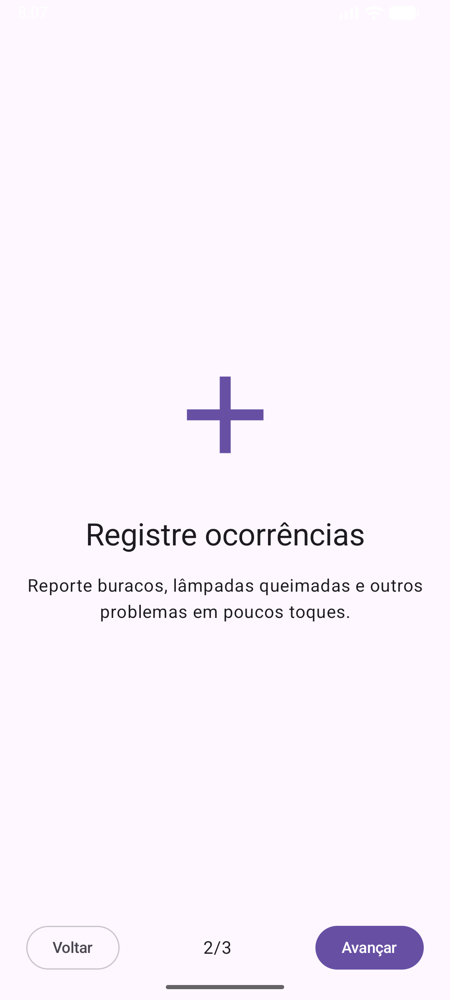
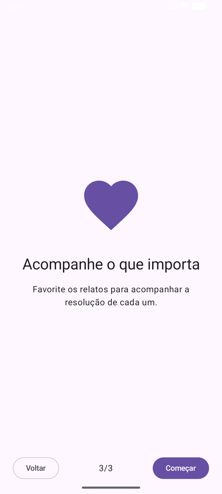
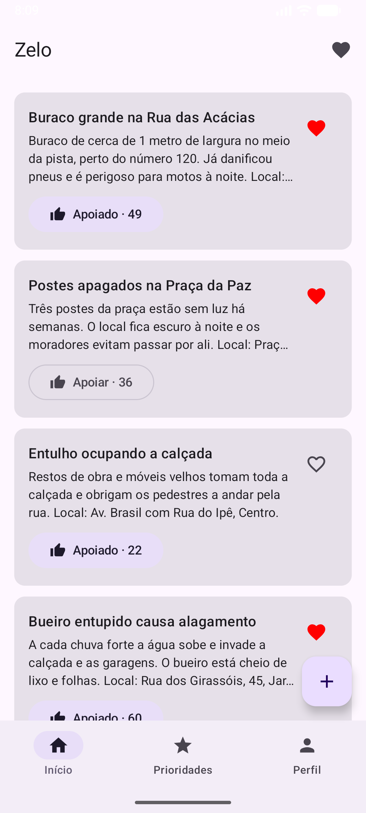
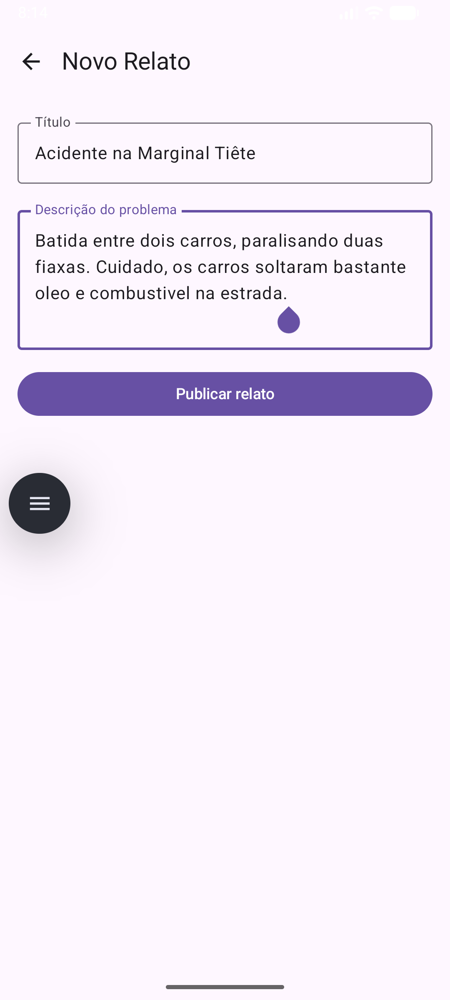
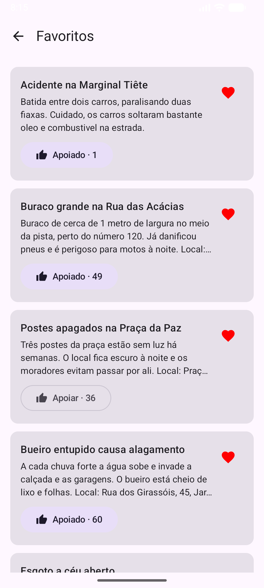
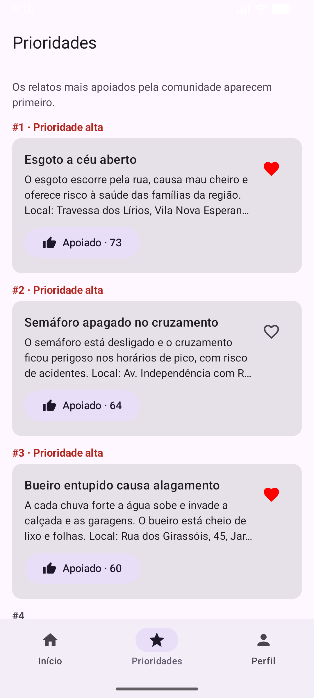
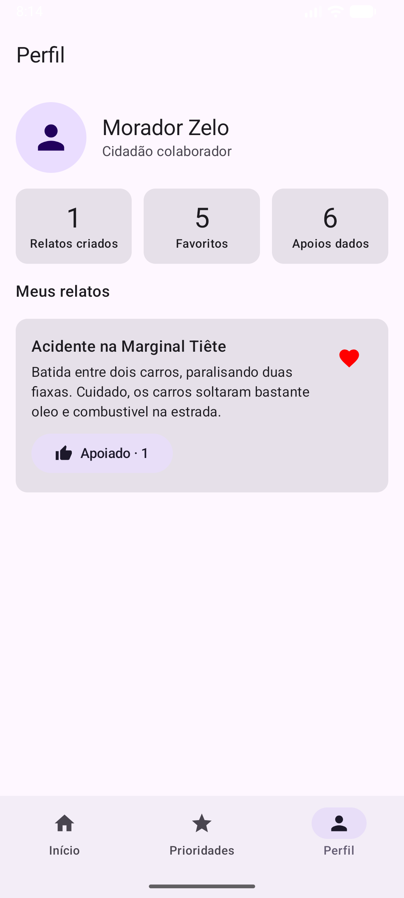

Zelo - Zeladoria Colaborativa Comunitária 🏙️

O Zelo é um aplicativo mobile focado em CitizenTech desenvolvido para a Global Solution (GS) da FIAP. O app funciona como um mapa colaborativo onde os cidadãos podem reportar e dar upvote (apoiar) problemas de infraestrutura local, como buracos nas ruas, focos de dengue ou falta de acessibilidade, ajudando a direcionar o poder público e a comunidade.

🎯 O Problema e a Solução

Canais oficiais de prefeituras costumam ser burocráticos e com pouca transparência. O Zelo empodera o morador, transformando-o em um "sensor" da cidade. Através de uma interface gamificada e acessível, os problemas mais votados pela comunidade ganham destaque, criando um termômetro real das prioridades de cada bairro.

📱 Funcionalidades (MVP)

O aplicativo atende aos requisitos obrigatórios da avaliação, incluindo:

Splash Screen e Onboarding: Apresentação do app com controle de visualização única via SharedPreferences.

Feed de Relatos: Listagem dinâmica de problemas reportados na cidade.

Interação (Upvote/Favorito): Validação comunitária com alteração de estado visual.

Navegação (Navigation Compose): Fluxo entre as telas de Home, Detalhe, Novo Relato e Favoritos.

Consumo de WebService: Integração com API REST usando Retrofit, com tratamento completo de estados (Loading, Success, Error).

🛠️ Tecnologias Utilizadas

Linguagem: Kotlin

Interface: Jetpack Compose (100% Declarativo, sem XML)

Arquitetura: MVVM (Model-View-ViewModel) e Clean Architecture

Navegação: Jetpack Navigation Compose

Network: Retrofit + GsonConverterFactory

Armazenamento Local: SharedPreferences

Gerenciamento de Estado: StateFlow / Coroutines

⚙️ Arquitetura e Integração com API

Nesta fase inicial de prototipação front-end, o aplicativo utiliza a API pública mockada JSONPlaceholder para simular o consumo de um WebService real e validar o comportamento do Retrofit e do fluxo de telas.

Nota: Na próxima fase, o Base URL será substituído pela API REST oficial do projeto, desenvolvida em Java com Spring Boot.

🌍 Conexão com os ODS da ONU

Este projeto foi desenvolvido com base nos Objetivos de Desenvolvimento Sustentável:

ODS 3: Saúde e Bem-Estar (mapeamento de focos de doenças).

ODS 9: Indústria, Inovação e Infraestrutura.

ODS 11: Cidades e Comunidades Sustentáveis.

🧑🏻‍💻 Desenvolvedores

| RM     | Nome Completo                      |
|--------|------------------------------------|
| 558073 | Carlos Henrique Miranda Villarinho |
| 558421 | Juliana Tami Kanashiro             |

📸 Telas do Aplicativo

Abaixo estão as capturas de tela demonstrando o fluxo e o design do aplicativo.

* Splash Screen  

* Onboarding (Passo 1)  

* Onboarding (Passo 2)  

* Onboarding (Passo 3)  

* Feed de Relatos (Home)  

* Formulário de Novo Relato  

* Meus Favoritos  

* Ranking de Prioridades  

* Perfil do Usuário  

